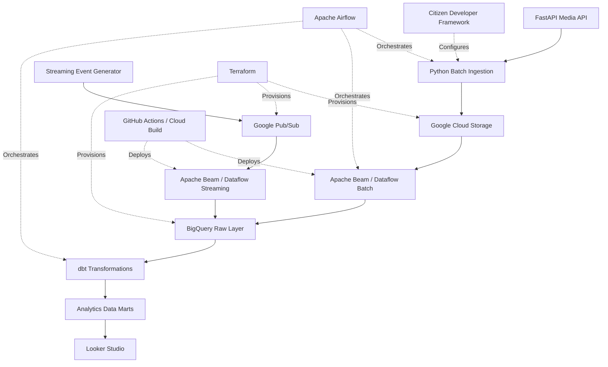

# GCP Media Data Platform

A production-oriented data engineering platform for media
analytics and self-service data pipeline development on
Google Cloud Platform.


## Project Overview

The project demonstrates how to design and implement
a scalable, secure and cost-conscious cloud data platform
for digital media analytics.

The platform is designed to support both batch and streaming
data ingestion, automated data transformations, infrastructure
management, orchestration and self-service pipeline development.

The project uses synthetic advertising data and does not
process real customer or confidential business information.

## Business Use Case

Digital advertising generates large volumes of data across
multiple platforms and marketing channels.

The platform aims to consolidate this data into a centralized
analytics environment, enabling consistent reporting and
data-driven decision-making.

Planned business metrics include:

- Impressions
- Clicks
- Conversions
- Advertising spend
- Revenue
- Click-through rate (CTR)
- Cost per click (CPC)
- Cost per acquisition (CPA)
- Return on ad spend (ROAS)

## Architecture

The following diagram represents the target architecture.
Not all components have been implemented yet.



## Technology Stack

| Layer | Technology | Status |
|---|---|---|
| Development | Python 3.12 | Implemented |
| Cloud authentication | Google Cloud ADC | Implemented |
| Configuration | Python, dotenv | Implemented |
| Automated testing | pytest, pytest-cov | Implemented |
| Code quality | Ruff | Implemented |
| Developer tooling | Make, Git, Docker | Configured |
| Infrastructure as Code | Terraform | Planned |
| Data source simulation | FastAPI | Planned |
| Data ingestion | Python, Cloud Storage | Planned |
| Batch processing | Apache Beam, Dataflow | Planned |
| Streaming | Pub/Sub, Dataflow | Planned |
| Data warehouse | BigQuery | Planned |
| Transformations | SQL, dbt | Planned |
| Orchestration | Apache Airflow | Planned |
| CI/CD | GitHub Actions, Cloud Build | Planned |
| Container registry | Artifact Registry | Planned |
| Self-service development | YAML-based framework | Planned |
| Observability | Cloud Logging, Monitoring | Planned |
| Visualization | Looker Studio | Planned |

## Citizen Developer Framework

The planned framework will allow developers to create
standardized data pipelines through configuration-driven
templates rather than implementing infrastructure and
operational logic from scratch.

Planned capabilities include:

- YAML-based pipeline configuration
- Reusable ingestion templates
- Configuration and schema validation
- Automated quality checks
- Security and cost guardrails
- Standardized logging and monitoring
- Automated deployment workflows

The initial configuration validation and application-level
cost guardrails have already been implemented.

## Engineering Principles

- Infrastructure as Code
- Configuration-driven development
- Separation of configuration and business logic
- Automated testing and continuous integration
- Least-privilege access
- Keyless cloud authentication
- Idempotent data processing
- Data quality and observability
- Cost-conscious architecture
- Reproducible development environments

## Repository Structure

```text
.
├── docs/
│   ├── architecture.md
│   └── cost_management.md
├── scripts/
│   └── check_gcp.py
├── src/
│   └── media_platform/
│       ├── __init__.py
│       └── settings.py
├── tests/
│   └── unit/
│       └── test_settings.py
├── .env.example
├── .gitignore
├── Makefile
├── pyproject.toml
├── requirements-lock.txt
└── README.md
```

## Local Development Setup

### Prerequisites

- Python 3.12
- Git
- GNU Make
- Google Cloud CLI
- A Google Cloud project for cloud authentication tests

Terraform and Docker will be required in later milestones.

### Installation

```bash
git clone https://github.com/Wiktor-Kaczorowski/gcp-media-data-platform.git
cd gcp-media-data-platform

python3 -m venv .venv
source .venv/bin/activate

python -m pip install --upgrade pip
python -m pip install -c requirements-lock.txt -e '.[dev]'

cp .env.example .env
```

Update `GCP_PROJECT_ID` in the local `.env` file.

### Google Cloud Authentication

```bash
gcloud auth login
gcloud config set project YOUR_PROJECT_ID

gcloud auth application-default login
gcloud auth application-default set-quota-project YOUR_PROJECT_ID
```

Service account keys are not required for local development.

### Development Commands

| Command | Description |
|---|---|
| `make install` | Install project dependencies |
| `make test` | Run unit tests |
| `make coverage` | Generate a coverage report |
| `make lint` | Run static code analysis |
| `make format` | Format Python source code |
| `make check` | Run quality checks and unit tests |
| `make smoke` | Validate local GCP authentication |

Unit tests do not require cloud credentials.

The smoke test requires valid Application Default Credentials
and a matching Google Cloud project configuration.

## Security and Cost Management

Paid cloud workloads are disabled by default in the
application configuration.

```dotenv
ALLOW_PAID_CLOUD_JOBS=false
ALLOW_COMPOSER_DEPLOYMENT=false
```

These settings are application-level controls and must be
enforced by the relevant execution scripts.

They do not replace Google Cloud IAM, quotas, billing alerts
or infrastructure-level safeguards.

For additional information, see:

- [Architecture](docs/architecture.md)
- [Cost Management](docs/cost_management.md)

## Development Roadmap

- [x] Stage 01: Project initialization and GCP setup
- [ ] Stage 02: Terraform infrastructure
- [ ] Stage 03: Synthetic media API
- [ ] Stage 04: Batch data ingestion
- [ ] Stage 05: Dataflow batch processing
- [ ] Stage 06: Pub/Sub messaging
- [ ] Stage 07: Dataflow streaming processing
- [ ] Stage 08: BigQuery data modeling
- [ ] Stage 09: dbt transformations
- [ ] Stage 10: Pipeline orchestration
- [ ] Stage 11: Citizen Developer Framework
- [ ] Stage 12: CI/CD automation
- [ ] Stage 13: Data quality and reliability
- [ ] Stage 14: Security and observability
- [ ] Stage 15: Analytics and visualization
- [ ] Stage 16: Final documentation and demonstration

## Current Milestone

The initial development environment, configuration layer,
cloud authentication, automated tests and developer tooling
have been implemented.

Latest local validation:

- 18 unit tests passed
- 100% statement coverage of the current Python package
- Ruff linting and formatting checks passed
- Google Cloud ADC smoke test passed

## Author

Wiktor Kaczorowski

Data Engineering Portfolio Project
