# GCP Media Data Platform


A production-inspired cloud data engineering platform for
processing digital advertising and media campaign data using
batch and streaming pipelines on Google Cloud Platform.

The project demonstrates infrastructure automation, data
ingestion, distributed processing, dimensional modeling,
workflow orchestration, data quality, configuration-driven
pipelines, and automated software delivery.

Built as an independent data engineering portfolio project
using synthetic media campaign data and real Google Cloud
services.

## Project Highlights

| Metric | Verified Result |
|---|---:|
| Terraform-managed resources | 44 |
| Python unit tests | 45 passed |
| SQL data quality assertions | 10 passed |
| Unique analytical events | 1,020 |
| Batch events after deduplication | 1,000 |
| Streaming events | 20 |
| BigQuery tables | 10 |
| Advertising campaigns | 6 |
| Dataflow batch execution | DONE |
| Dataflow streaming execution | DRAINED |
| Airflow refresh DAG | SUCCESS |
| GitHub Actions CI | SUCCESS |
| Cloud Build execution | SUCCESS |
| Cloud Build duration | 30 seconds |
| Docker image size | 49.86 MB |

## Business Context

Marketing teams collect campaign performance data from
multiple advertising platforms and geographical markets.

The objective is to consolidate these datasets into a
consistent analytical platform that supports:

- Cross-platform campaign performance analysis.
- Advertising spend and revenue monitoring.
- Campaign efficiency measurement.
- Batch and streaming data ingestion.
- Automated data quality validation.
- Governed configuration-driven data processing.

The synthetic source represents six campaigns across Google
Ads, Meta Ads, YouTube Ads and TikTok Ads.

## Architecture

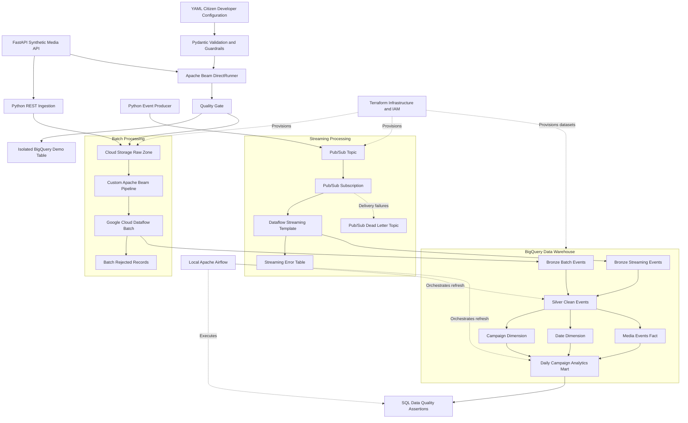

### Software Delivery

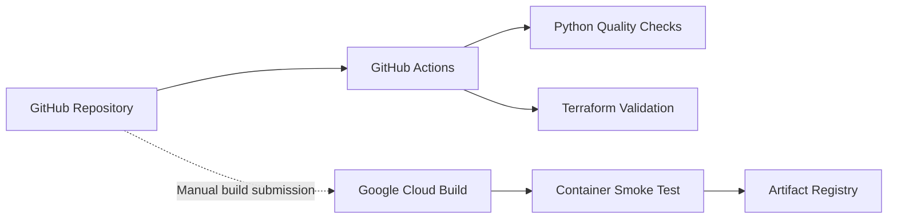

## Technology Stack

| Area | Technologies |
|---|---|
| Programming | Python, SQL, Bash |
| Source API | FastAPI, Uvicorn |
| Infrastructure as Code | Terraform |
| Object Storage | Google Cloud Storage |
| Messaging | Google Cloud Pub/Sub |
| Batch Processing | Apache Beam, Google Cloud Dataflow |
| Streaming | Dataflow Classic Template |
| Data Warehouse | BigQuery |
| Data Modeling | Medallion Architecture, Star Schema |
| Orchestration | Apache Airflow |
| Configuration | YAML, Pydantic |
| Testing | Pytest, SQL ASSERT |
| Code Quality | Ruff |
| Continuous Integration | GitHub Actions |
| Containerization | Docker |
| Build and Packaging | Google Cloud Build |
| Artifact Management | Artifact Registry |
| Security | IAM, dedicated service accounts |
| Observability | Cloud Logging, Dataflow metrics |

## Data Engineering Pipelines

### Batch Pipeline

The batch pipeline extracts synthetic campaign events from
a REST API and stores them in Cloud Storage as JSONL files.

A custom Apache Beam pipeline:

1. Reads source files from Cloud Storage.
2. Parses JSON records.
3. Validates required fields and data types.
4. Applies business validation rules.
5. Separates valid and invalid records.
6. Adds ingestion and batch metadata.
7. Loads valid records into BigQuery.
8. Writes rejected records into a quarantine table.

The pipeline was tested locally with DirectRunner and
executed successfully on managed Google Cloud Dataflow.

Batch output tables are optimized using date partitioning
and clustering by campaign and advertising platform.

### Streaming Pipeline

A Python producer publishes campaign events to Pub/Sub.

A Google-provided Dataflow Pub/Sub Subscription to
BigQuery template processes messages and writes them
to the BigQuery Bronze layer.

The streaming pipeline includes:

- Pub/Sub topics and subscriptions.
- Configured dead-letter topic.
- Dataflow error output table.
- Dedicated worker service account.
- Explicit worker limits.
- Controlled shutdown using drain.

The streaming job was executed on Google Cloud and
successfully drained after the demonstration.

### Batch and Streaming Integration

Both ingestion paths use a compatible event schema,
allowing downstream SQL models to consolidate them
into a single analytical dataset.

Source metadata identifies the ingestion method,
batch identifier and ingestion timestamp.

## Data Warehouse

The warehouse follows a Medallion Architecture with
Bronze, Silver and Gold datasets.

### Bronze Layer

| Table | Purpose |
|---|---|
| raw_batch_events | Validated batch records |
| raw_streaming_events | Streaming records |
| rejected_events | Batch validation failures |
| streaming_error_records | Streaming processing errors |
| citizen_demo_events | Isolated framework demonstration |

### Silver Layer

| Table | Purpose |
|---|---|
| media_events | Consolidated and deduplicated events |

Silver transformations include:

- Schema-compatible source consolidation.
- Business rule validation.
- Data type normalization.
- Conversion of financial values to NUMERIC.
- Deterministic deduplication using window functions.
- Date partitioning and clustering.

The implementation uses CTEs, UNION ALL BY NAME,
SAFE_CAST, ROW_NUMBER and QUALIFY.

### Gold Layer

| Table | Grain |
|---|---|
| dim_campaign | One row per campaign |
| dim_date | One row per calendar date |
| fact_media_events | One row per unique event |
| mart_campaign_daily | One row per campaign and date |

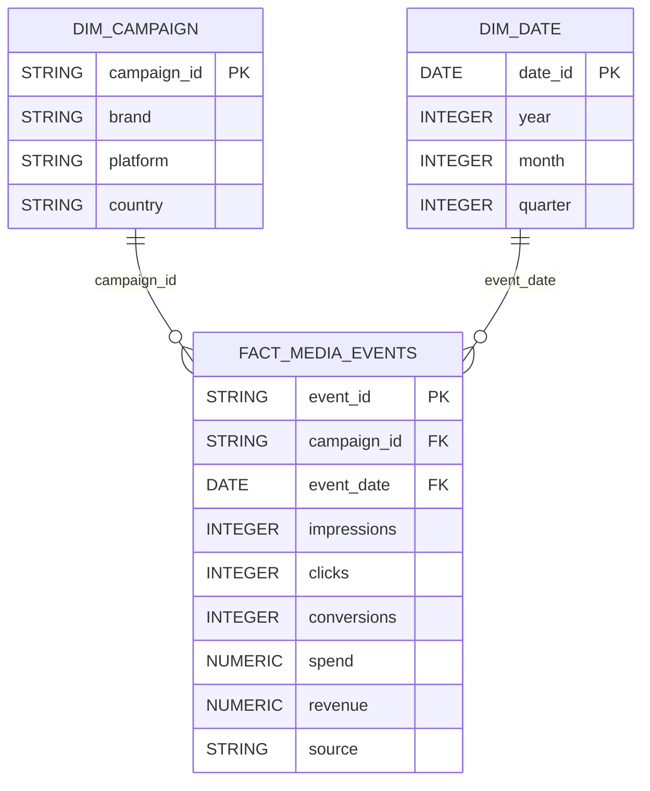

Keys in the diagram represent logical relationships.
Referential integrity is verified using SQL assertions.

## Business Analytics

The Gold layer provides the following business metrics:

| KPI | Formula |
|---|---|
| CTR | Clicks / Impressions * 100 |
| CPC | Spend / Clicks |
| CPM | Spend / Impressions * 1000 |
| CPA | Spend / Conversions |
| Conversion Rate | Conversions / Clicks * 100 |
| ROAS | Revenue / Spend |

Ratios are calculated from aggregated measures instead
of averaging event-level ratios.

SAFE_DIVIDE protects calculations from division by zero.

### Demonstration Results

The following results were obtained from the actual
BigQuery analytical mart on November 24, 2026.

| Metric | Result |
|---|---:|
| Campaigns | 6 |
| Unique events | 1,020 |
| Impressions | 5,213,056 |
| Clicks | 330,633 |
| Conversions | 25,574 |
| Advertising spend | 445,337.04 |
| Revenue | 2,207,208.48 |
| CTR | 6.34% |
| ROAS | 4.96x |

Financial values represent synthetic monetary units.
They are not actual advertising expenditures.

### Campaign Performance

| Campaign | Platform | Country | ROAS |
|---|---|---|---:|
| CAM-001 | Google Ads | PL | 5.5895 |
| CAM-006 | Meta Ads | FR | 5.1043 |
| CAM-003 | YouTube Ads | GB | 5.0641 |
| CAM-005 | TikTok Ads | PL | 4.9476 |
| CAM-004 | Google Ads | US | 4.6561 |
| CAM-002 | Meta Ads | DE | 4.4705 |

## Data Quality

The platform implements data quality controls at
multiple stages:

### Ingestion and Processing

- Required field validation.
- Data type validation.
- Non-negative business metrics.
- Timestamp validation.
- Clicks cannot exceed impressions.
- Conversions cannot exceed clicks.
- Invalid record quarantine.

### Warehouse Quality Gates

Ten SQL assertions verify:

1. Silver data availability.
2. Unique event identifiers.
3. Valid business metrics.
4. Unique campaign keys.
5. Campaign referential integrity.
6. Date referential integrity.
7. Silver-to-Fact row reconciliation.
8. Aggregated event count reconciliation.
9. Advertising spend reconciliation.
10. Unique daily campaign grain.

All ten assertions passed in Google BigQuery.

## Apache Airflow Orchestration

The project includes a seven-task DAG with branching,
retries, execution timeouts and runtime parameters.

Two execution modes are supported:

- `refresh`: rebuild Silver and Gold from existing
  Bronze data and execute SQL quality assertions.
- `full`: ingest new source data, submit and monitor
  Dataflow Batch, and execute warehouse transformations.

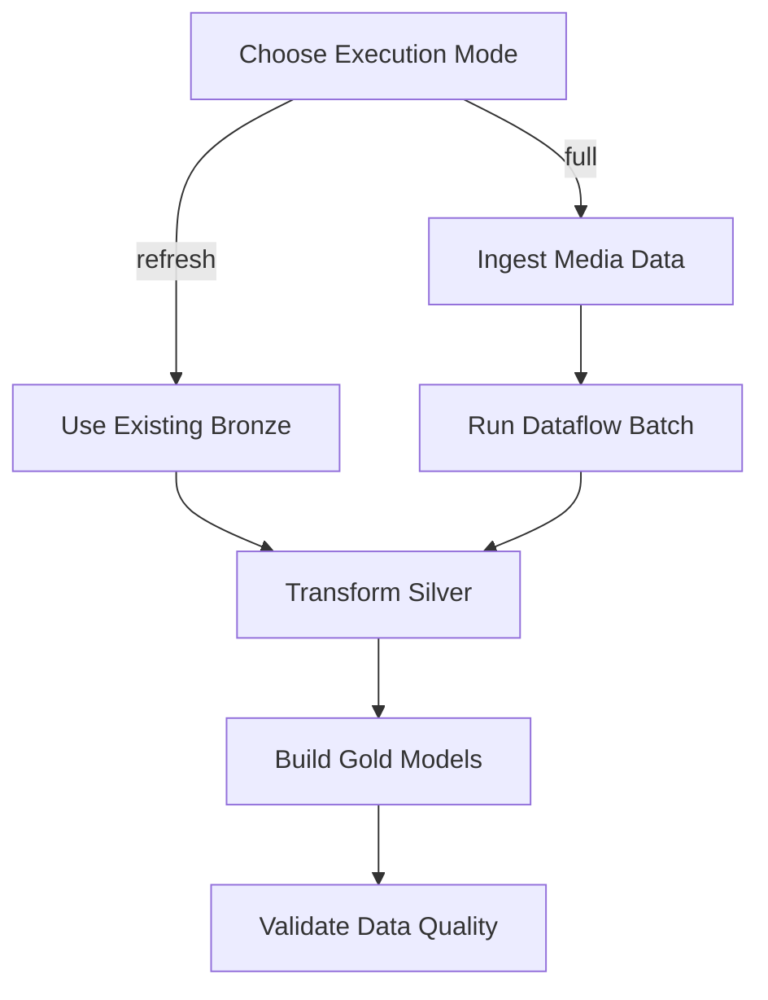

The refresh workflow was successfully executed using
local Apache Airflow against real Google BigQuery.

The full workflow is implemented but has not been
integration-tested through Airflow due to cloud cost
constraints.

Dataflow Batch itself was independently tested on GCP.

Cloud Composer is not deployed.

## Citizen Developer Framework

The framework enables configuration-driven execution of
approved data pipelines without modifying Python code.

Users define pipeline parameters in YAML files.

Pydantic models enforce:

- Strict configuration schemas.
- Approved source endpoints.
- Approved destination tables.
- Maximum input record counts.
- Allowed execution runners.
- Data quality thresholds.
- Explicit publication authorization.

The framework reuses the existing ingestion and
Apache Beam processing components.

### Execution Modes

**Preview**

Executes the pipeline locally and returns validation
results without publishing data to GCP.

**Publish**

Requires an explicit command-line flag and writes
validated data to approved Cloud Storage and BigQuery
destinations.

### Verified Framework Results

| Test | Result |
|---|---|
| Valid configuration | Accepted |
| Unsafe configuration | Rejected |
| Unsafe configuration violations | 7 |
| Preview execution | SUCCESS |
| Publish without permission flag | Rejected |
| Cloud Storage publication | SUCCESS |
| BigQuery publication | SUCCESS |
| Published records | 21 |
| Unique published events | 20 |
| Rejected source records | 1 |

The publication target is isolated from the main
analytical warehouse.

This implementation is a self-service proof of concept,
not a complete multi-tenant authorization platform.

## Infrastructure and Security

Terraform manages 44 infrastructure resources,
including:

- Required Google Cloud APIs.
- Cloud Storage buckets.
- BigQuery datasets.
- Pub/Sub topics and subscriptions.
- Dead-letter configuration.
- Dedicated service accounts.
- IAM role bindings.
- VPC network and subnetwork.
- Dataflow firewall configuration.
- Artifact Registry repository.

Infrastructure validation and drift detection were
completed successfully.

Security and operational controls include:

- Dedicated workload identities.
- Resource-scoped IAM permissions where applicable.
- Application Default Credentials for local development.
- No service account key files required.
- Cloud Storage public access prevention.
- Explicit cloud execution guardrails.
- Restricted build source context.
- Non-root Docker container.
- Exclusion of local credentials and Terraform state
  from version control.

## CI/CD and Software Delivery

GitHub Actions automatically runs:

- Dependency installation and validation.
- Python linting.
- Python formatting checks.
- Unit tests.
- Shell syntax validation.
- YAML configuration validation.
- Terraform formatting and validation.

Cloud Build provides a separate delivery workflow:

1. Build the FastAPI Docker image.
2. Execute a container smoke test.
3. Publish the versioned image to Artifact Registry.

The build uses a dedicated service account and
commit-based image tags.

Verified image:

`media-source-api:61c7132`

Build duration: 30 seconds.

Image size: approximately 49.86 MB.

The CI workflow is automated. Cloud Build submission is
manual. Automatic application deployment is not included.

## Repository Structure

```text
gcp-media-data-platform/
├── .github/
│   └── workflows/
│       └── ci.yml
├── configs/
│   ├── campaign_preview.yaml
│   ├── campaign_publish.yaml
│   └── invalid_pipeline.yaml
├── dags/
│   └── media_batch_pipeline.py
├── docker/
│   └── requirements-api.txt
├── docs/
├── infrastructure/
│   └── terraform/
├── scripts/
│   ├── airflow_env.sh
│   ├── run_airflow_batch.sh
│   ├── run_batch.py
│   ├── run_sql.sh
│   └── run_stream.sh
├── sql/
│   ├── 01_silver.sql
│   ├── 02_gold.sql
│   └── 03_quality.sql
├── src/
│   └── media_platform/
│       ├── api.py
│       ├── batch.py
│       ├── events.py
│       ├── framework.py
│       ├── ingestion.py
│       ├── producer.py
│       └── settings.py
├── tests/
│   └── unit/
├── Dockerfile
├── cloudbuild.yaml
├── Makefile
├── pyproject.toml
├── requirements-lock.txt
└── README.md
```

## Getting Started

### Requirements

- Python 3.12
- Google Cloud CLI
- Terraform
- A Google Cloud project with billing enabled for
  cloud integration tests
- Docker for container-related development

### Local Setup

```bash
git clone https://github.com/Wiktor-Kaczorowski/gcp-media-data-platform.git
cd gcp-media-data-platform

python3.12 -m venv .venv
source .venv/bin/activate

python -m pip install -r requirements-lock.txt
python -m pip install --no-deps -e '.[dev]'

make check
```

### Start the Source API

```bash
python -m uvicorn media_platform.api:app \
  --host 127.0.0.1 \
  --port 8000
```

API documentation:

`http://127.0.0.1:8000/docs`

Health endpoint:

`http://127.0.0.1:8000/health`

### Validate a Citizen Developer Configuration

```bash
python -m media_platform.framework \
  --config configs/campaign_preview.yaml \
  --validate-only
```

### Execute a Local Preview

Start the source API in a separate terminal first.

```bash
python -m media_platform.framework \
  --config configs/campaign_preview.yaml
```

### Run Automated Tests

```bash
make check
```

### Validate Terraform

```bash
terraform -chdir=infrastructure/terraform init \
  -backend=false

terraform -chdir=infrastructure/terraform validate
```

### Cloud Integration

The existing cloud configuration targets a development
project in the us-central1 region.

Before deploying into another project, review and update
the project-specific identifiers in Terraform, SQL,
environment settings and shell scripts.

Authenticate locally using Google Cloud CLI and
Application Default Credentials.

Review all infrastructure plans and estimated costs
before applying Terraform or submitting cloud jobs.

Paid Dataflow jobs are disabled by default.

### Airflow

Airflow is installed into a separate virtual environment
to avoid dependency conflicts with Apache Beam.

```bash
python3.12 -m venv "$HOME/.venvs/media-airflow"

"$HOME/.venvs/media-airflow/bin/python" -m pip install \
  "apache-airflow==2.11.2" \
  --constraint "https://raw.githubusercontent.com/apache/airflow/constraints-2.11.2/constraints-3.12.txt"

source scripts/airflow_env.sh

airflow db migrate
```

Execute the refresh workflow:

```bash
airflow dags test \
  media_batch_pipeline \
  "$(date -u +%Y-%m-%dT%H:%M:%S+00:00)" \
  --conf '{"mode":"refresh"}'
```

A configured BigQuery environment containing the source
Bronze tables is required.

## Cost Optimization

The platform uses several cost-control techniques:

- Small demonstration data volumes.
- Bounded Dataflow worker counts.
- Explicit permission to launch paid cloud jobs.
- Controlled streaming shutdown.
- BigQuery partitioning and clustering.
- Maximum bytes billed limits.
- Cloud Storage lifecycle policies.
- BigQuery table expiration policies.
- Local Airflow instead of managed Cloud Composer.
- Short-lived Cloud Build execution.

At the end of the verified demonstration, there were
no active Dataflow jobs or Compute Engine instances.

Storage and other retained cloud resources may still
generate charges.

## Engineering Trade-offs

The project intentionally balances architectural
completeness against development time and cloud costs.

Current limitations:

- Synthetic rather than production business data.
- A single development environment.
- Local Terraform state.
- Full-refresh SQL transformations instead of MERGE.
- A simplified campaign dimension without SCD Type 2.
- A fixed calendar dimension covering 2026 and 2027.
- Local Airflow with SQLite and SequentialExecutor.
- Untested full Dataflow orchestration through Airflow.
- A Google-provided streaming template rather than a
  custom streaming Beam implementation.
- Application-level Citizen Developer guardrails rather
  than multi-tenant authorization.
- Manual Cloud Build submission.
- No automated production deployment.
- No large-scale performance or load testing.

## Future Improvements

- Incremental warehouse models and MERGE operations.
- Managed orchestration using Cloud Composer.
- Workload Identity Federation for CI/CD.
- Remote Terraform state and environment separation.
- Custom streaming transformations and windowing.
- Stronger idempotency and replay mechanisms.
- Automated integration and performance testing.
- Data lineage and operational alerting.
- Multi-tenant Citizen Developer permissions.
- Automated deployment and release promotion.
- BI dashboards and semantic modeling.


## Execution Evidence

### Dataflow Batch

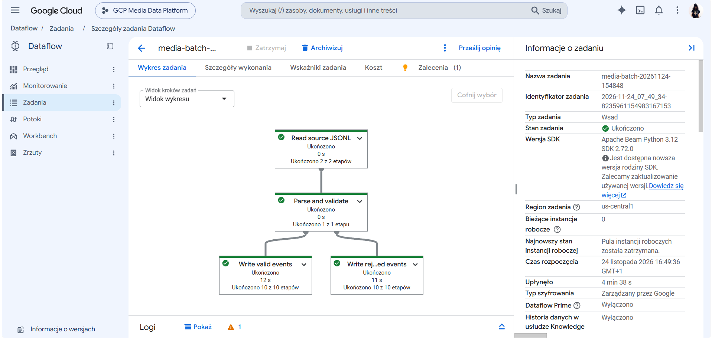

### Dataflow Streaming

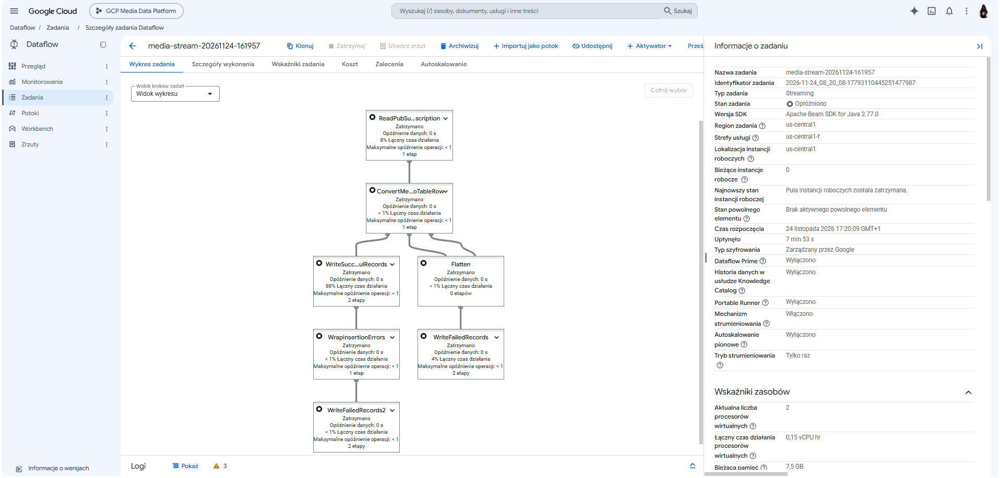

### BigQuery Warehouse

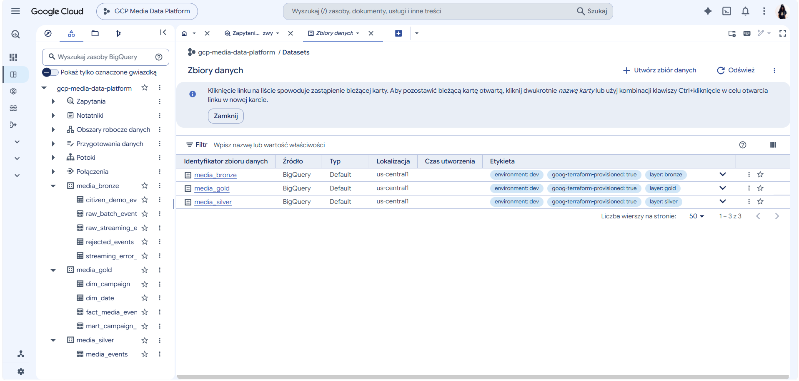

### Business Analytics

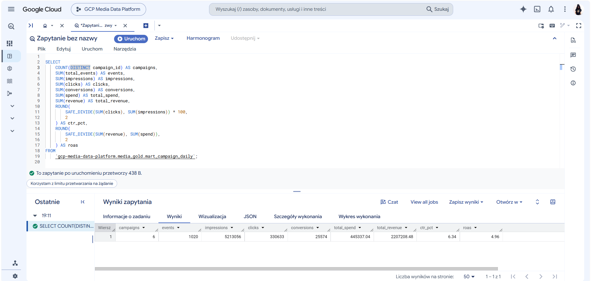

### Apache Airflow

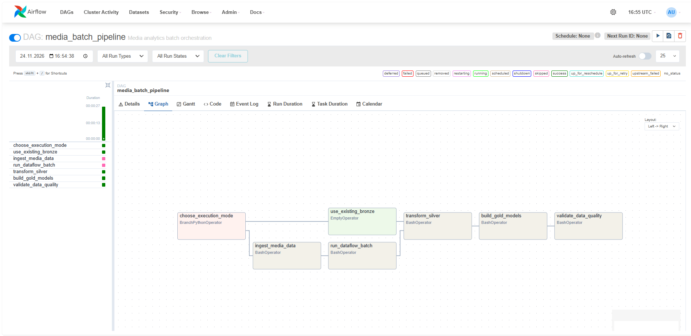

### Continuous Integration

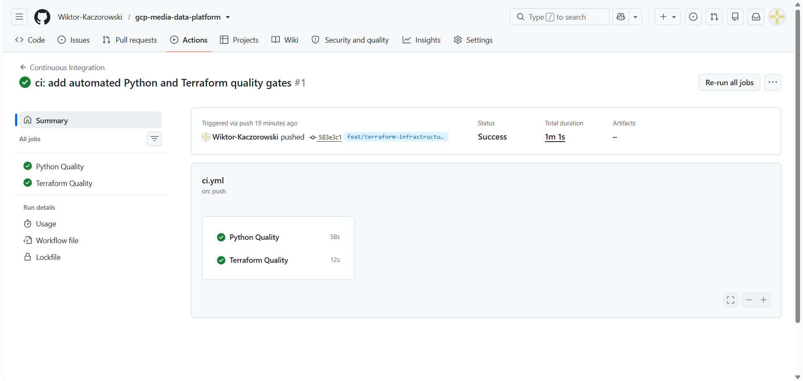

### Cloud Build

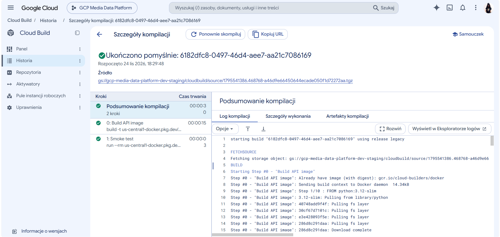

### Artifact Registry

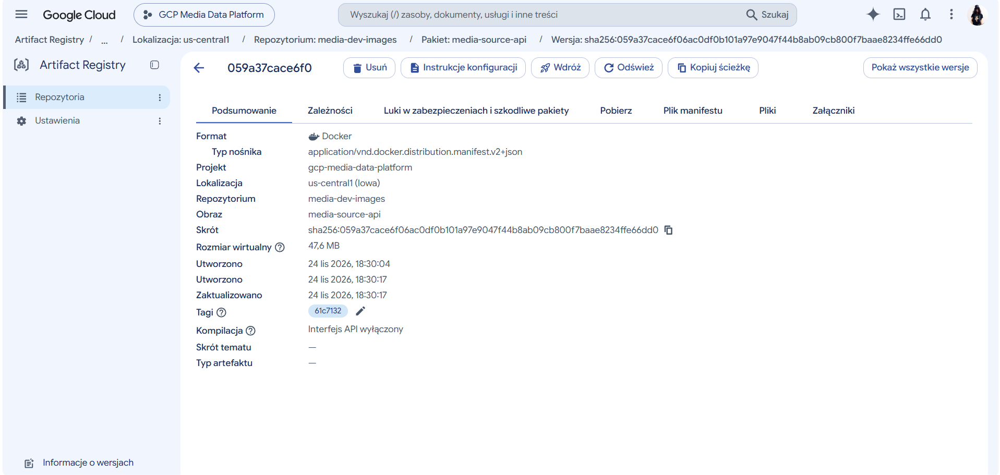

## Author

Wiktor Kaczorowski

Independent Data Engineering Portfolio Project

GitHub: https://github.com/Wiktor-Kaczorowski
